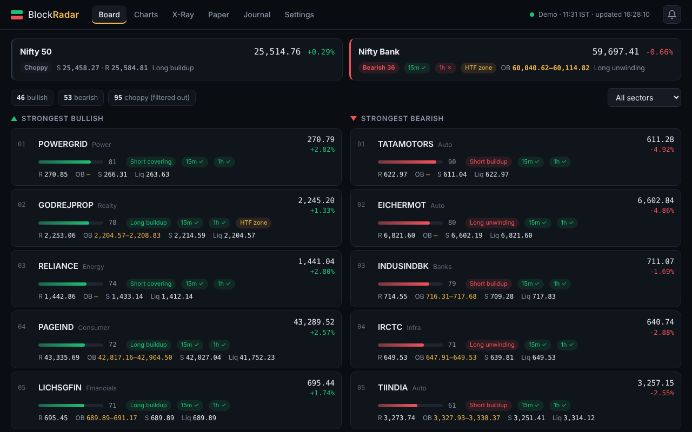
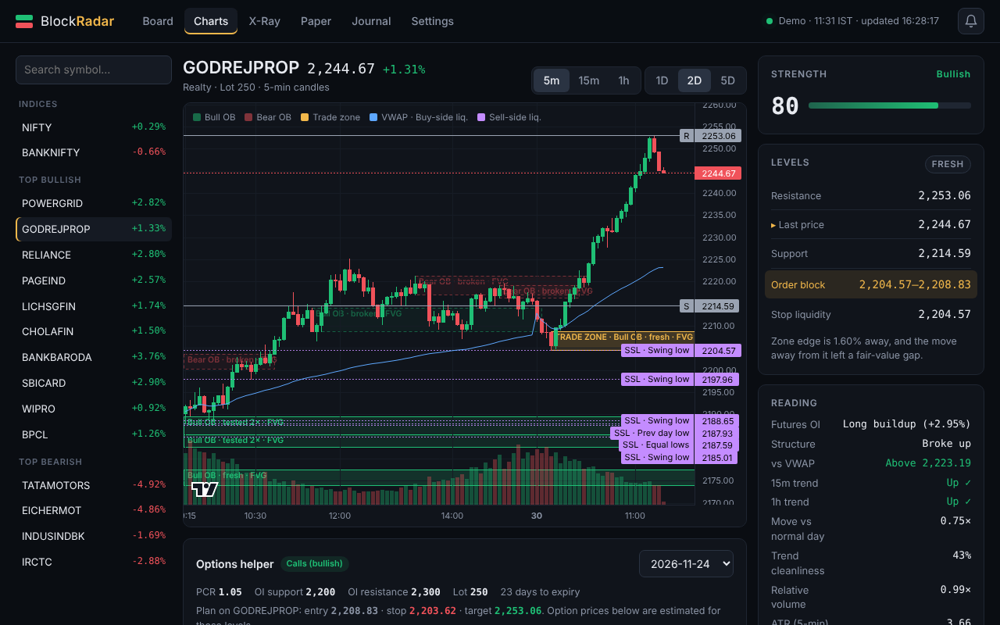
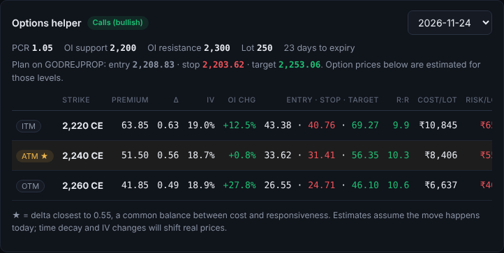
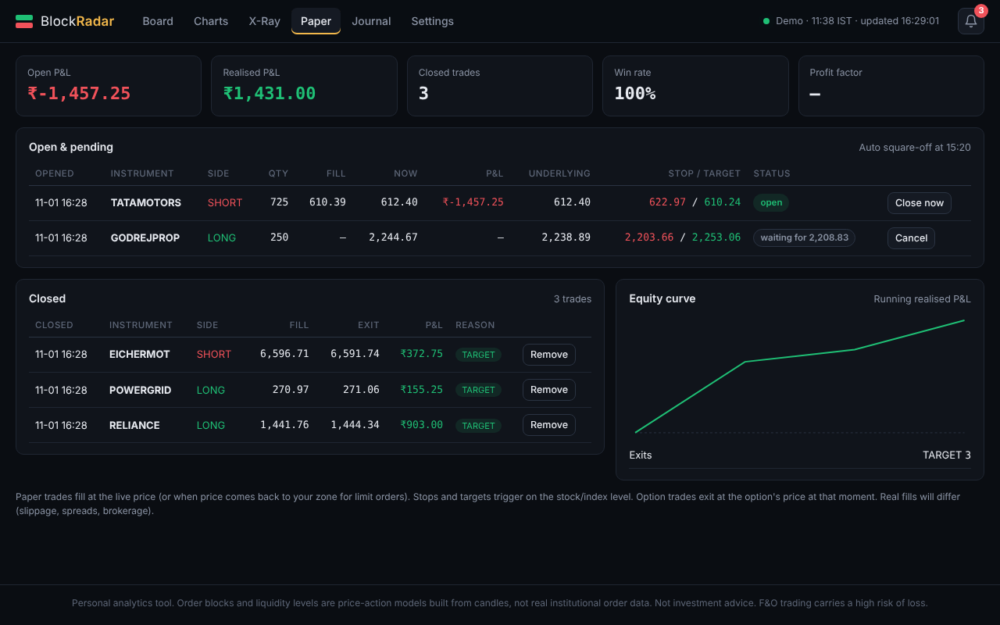
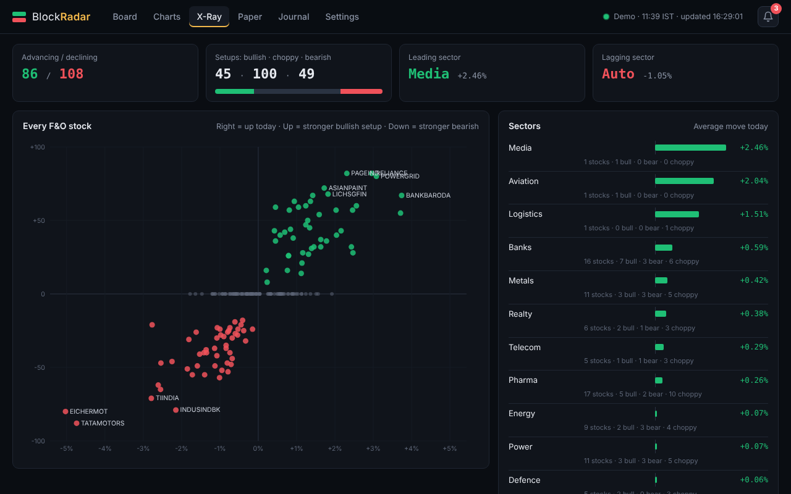
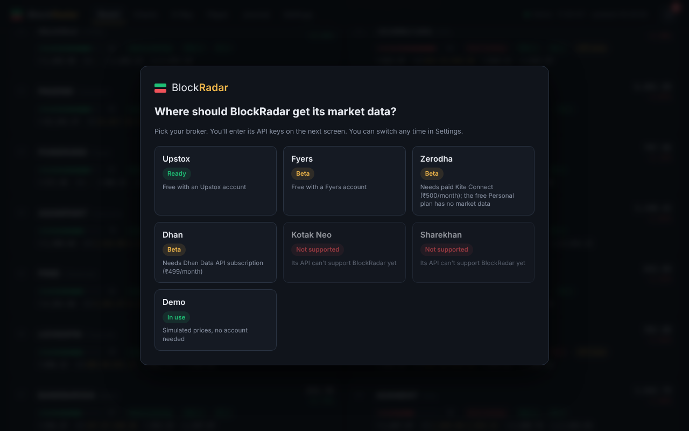

# BlockRadar

**A free, open-source order-block and liquidity scanner for Indian F&O stocks, NIFTY and BANKNIFTY.**
It runs on your own computer, connects to your own broker account, and shows you, every minute, which stocks have the strongest bullish and bearish setups, with the exact price zones to watch.



> **Important:** BlockRadar is an analysis tool, not investment advice. It does **not** place real orders.
> Order blocks and liquidity levels are patterns calculated from price candles; they are not real
> institutional order data. Trading futures & options carries a high risk of loss. Practice with the
> built-in paper trading before risking money.

---

## Contents

1. [What BlockRadar does](#what-blockradar-does)
2. [Quick start (Windows)](#quick-start-windows)
3. [Connect your broker](#connect-your-broker)
4. [How to use it: a daily routine](#how-to-use-it-a-daily-routine)
5. [What the words mean](#what-the-words-mean)
6. [Troubleshooting](#troubleshooting)
7. [Safety & privacy](#safety--privacy)
8. [For developers](#for-developers)
9. [Limits](#limits)
10. [License & credits](#license--credits)

---

## What BlockRadar does

| Screen | What you get |
|---|---|
| **Board** | NIFTY and BANKNIFTY at the top, then the 20 strongest **bullish** and 20 strongest **bearish** F&O stocks, re-ranked every minute. Each row shows the order-block zone, support, resistance, the nearest liquidity level, the futures OI reading (long buildup, short covering…) and whether the 15-min and 1-hour charts agree. Choppy stocks are hidden. |
| **Charts** | 5-min, 15-min or 1-hour candles with order-block boxes, liquidity lines, support, resistance and VWAP drawn for you. A side card explains the setup in plain numbers. |
| **Options helper** | Under each chart: suggests calls or puts, shows ITM / ATM / OTM strikes with premium, delta, IV and OI change, and converts the stock's entry / stop / target into option prices, cost per lot, risk per lot and time decay per day. |
| **Paper trading** | Practise without money. Take a simulated trade on the stock, index or an option, either straight away or as a "limit at zone" order that waits for price to come back. Stops, targets and the 15:20 square-off are handled automatically. |
| **Alerts** | Sound, desktop pop-up and optional Telegram message when a strong stock enters its zone, when a liquidity trap fires, or when a paper trade hits its stop or target. |
| **X-Ray** | Every F&O stock on one map, plus market breadth and which sectors are leading or lagging. |
| **Journal** | Log your real trades and see win rate, average R and profit factor, broken down by setup. |

<table>
<tr>
<td width="50%"><br><sub>Chart: gold box = trade zone, purple/blue lines = liquidity</sub></td>
<td width="50%"><br><sub>Options helper: zone levels translated into option prices</sub></td>
</tr>
<tr>
<td><br><sub>Paper trading (simulated demo data, not real results)</sub></td>
<td><br><sub>X-Ray: whole market and sectors at a glance</sub></td>
</tr>
</table>

---

## Quick start (Windows)

You need about 5 minutes and an internet connection.

**1. Install Python** (one time)
Download Python 3.10 or newer from <https://www.python.org/downloads/>.
During setup, **tick "Add python.exe to PATH"**. (If you already have Anaconda, that works too.)

**2. Download BlockRadar**
On this page click the green **Code** button → **Download ZIP**. Right-click the ZIP → **Extract All**.

**3. Start it**
Open the extracted folder and double-click **`start.bat`**.
- The first time, it installs what it needs (about a minute).
- Your browser opens at **http://127.0.0.1:8000**.
- Keep the black window open while you use BlockRadar. Closing it stops the app.

**4. Choose your data source**
On first launch, BlockRadar asks where to get market data. Pick your broker (next section), or pick **Demo** to try everything with simulated prices first.

> On Mac or Linux, see [For developers](#for-developers) for the two commands to run instead of `start.bat`.



---

## Connect your broker

BlockRadar uses **your own** broker API keys. They are saved only on your computer.

| Broker | Status | Market-data cost | How you log in |
|---|---|---|---|
| **Upstox** | ✅ Ready (tested with a live account) | Free | "Connect" button, once each morning |
| **Fyers** | 🧪 Beta | Free | "Connect" button, once each morning |
| **Zerodha** | 🧪 Beta | Paid Kite Connect, ₹500/month (the free "Personal" plan has no market data) | "Connect" button, once each morning |
| **Dhan** | 🧪 Beta | Dhan Data API subscription, ₹499/month | Paste an access token (lasts 24 hours) |
| Kotak Neo | ❌ Not supported | Its API has no historical candles | — |
| Sharekhan | ❌ Not supported | No REST price quotes; intraday candles not documented | — |

**Beta** means the connector was built from the broker's official API documentation and SDK and tested against a simulated API, but hasn't been confirmed with a real account yet. If you use one, please [open an issue](../../issues) to say whether it worked.

All the steps below happen in BlockRadar's **Settings → Data source**: click your broker's card, fill in the boxes, and connect.

### Upstox
1. Go to <https://account.upstox.com/developer/apps> → **New App**.
2. Set **Redirect URL** to exactly: `http://127.0.0.1:8000/auth/callback`
3. Copy the **API key** and **API secret** into BlockRadar → **Save keys** → **Connect Upstox** → log in.

### Fyers
1. Go to <https://myapi.fyers.in/dashboard> → **Create App**.
2. Set **Redirect URL** to exactly: `http://127.0.0.1:8000/auth/fyers/callback` and allow data access.
3. Copy the **App ID** (it ends in `-100`) and **Secret ID** into BlockRadar → **Save keys** → **Connect Fyers** → log in.

### Zerodha
1. Go to <https://developers.kite.trade> → create a **Kite Connect** app (paid plan).
2. Set **Redirect URL** to exactly: `http://127.0.0.1:8000/auth/zerodha/callback`
3. Copy the **API key** and **API secret** into BlockRadar → **Save keys** → **Connect Zerodha** → log in.

Zerodha has no option-chain API, so BlockRadar builds the chain from the contract list and calculates IV and Greeks itself.

### Dhan
1. Log in to <https://web.dhan.co> → **My Profile → Access DhanHQ APIs**.
2. Make sure the **Data API** subscription is active, then **generate an access token**.
3. Paste your **Client ID** and the **token** into BlockRadar → **Save & connect**.

Dhan allows only 1 chart request per second, so the first load takes about 7–8 minutes. After that it updates every minute.

### Every trading morning
Broker logins expire overnight. When BlockRadar shows **"login needed"**, click the **Connect** link in the yellow bar. (For Dhan, paste a fresh token in Settings.)

---

## How to use it: a daily routine

1. **Start BlockRadar before 9:15** and reconnect your broker if asked.
2. **Wait until about 9:30.** The first 10–15 minutes are noisy, and the rankings need a few candles to settle.
3. **Check X-Ray** for the market's mood. If most stocks are bearish, favour shorts; if most are bullish, favour longs.
4. **Shortlist 2–3 stocks on the Board.** Look for:
   - strength **60+**,
   - an OI reading that agrees (long buildup for longs, short buildup for shorts),
   - **15m ✓ 1h ✓** (the bigger timeframes agree).
5. **Open the chart and wait for price to come back into the gold trade zone.** Don't chase a stock that has already run far from its zone.
6. **Plan the trade before entering:**
   - **Stop:** just beyond the far side of the zone.
   - **Target:** the target-liquidity level, or the next support/resistance.
   - Skip it if the reward is less than about **1.5× the risk** (the app tells you when that's the case).
7. **Size the position** so that hitting the stop loses no more than you've decided per trade (for example 1% of your capital).
8. **Practise first with Paper trading** for a few weeks. Then compare your results in the **Journal**, broken down by setup, to see what actually works for you.

Turn on alerts in **Settings → Alerts** so you don't have to watch the screen all day.

---

## What the words mean

| Term | Meaning in BlockRadar |
|---|---|
| **Order block (OB)** | The last opposite-coloured candle before a strong move that broke the previous swing high or low. Price often reacts when it comes back to this zone. **Fresh** = not revisited yet; **tested** = price came back; **broken** = price closed through it (no longer valid). |
| **Trade zone** | The most recent valid order block in the direction of the setup, highlighted in gold. |
| **Liquidity** | Price levels where many stop-losses are likely to sit: equal highs or lows, the previous day's high or low, and old swing points. **Buy-side** levels are above price, **sell-side** levels below. |
| **Liquidity trap** | Price briefly pushed through a liquidity level (triggering stops) and then closed back on the other side. This often happens before a move in the opposite direction. |
| **Futures OI reading** | Price ↑ + OI ↑ = **long buildup**; price ↓ + OI ↑ = **short buildup**; price ↑ + OI ↓ = **short covering**; price ↓ + OI ↓ = **long unwinding**. |
| **Strength (0–100)** | One score combining: how big today's move is compared with a normal day for that stock, the trend structure, the VWAP side, nearby order blocks, traps, OI, relative volume and higher-timeframe agreement. It is **0** for choppy stocks. |
| **15m ✓ / 1h ✓** | The 15-minute or 1-hour chart agrees with the setup. ✗ means it disagrees. |
| **HTF zone** | The 5-min zone overlaps an order block on a higher timeframe, which makes it a stronger zone. |
| **R:R (reward : risk)** | How far the target is compared with how far the stop is. 2.0 means you could make twice what you risk. |
| **PCR / OI support / OI resistance** | Put-call ratio, and the strikes with the most put writing (a floor) and call writing (a ceiling). |

---

## Troubleshooting

| Problem | Fix |
|---|---|
| **"Python was not found"** | Reinstall Python and tick **"Add python.exe to PATH"**, then run `start.bat` again. |
| **Browser says "can't reach this page"** | Make sure the black `start.bat` window is still open. Wait 5 seconds and refresh. |
| **"Login needed" / "token expired"** | Normal every morning. Click **Connect** (or paste a new Dhan token). |
| **Broker login page says redirect URL mismatch** | The Redirect URL in your broker app must match the one in Settings **exactly**, including `http://` and the port `8000`. |
| **"Data API subscription not active" (Dhan)** or **"no market-data permission" (Zerodha)** | Those brokers charge for market data; activate the plan shown in the table above. |
| **Board is empty after the market closes** | It shows the last session. Live updates resume at 9:15 on the next trading day. |
| **"Reward is smaller than the risk"** | The stock has run far from its zone. Wait for a pullback instead of chasing. |
| **Port 8000 already in use** | Another copy is running. Close the other black window. |
| **Setup failed while installing** | Check your internet connection, delete the `.venv` folder and run `start.bat` again. |

Still stuck? [Open an issue](../../issues) and describe what you see. **Never paste your API keys or tokens.**

---

## Safety & privacy

- **Your keys stay on your computer.** API keys, secrets, login tokens, your journal and your paper trades are stored only in the `data/` folder, which is excluded from Git. Don't share that folder.
- Secret fields are never sent back to the browser; they just show "saved".
- The app only listens on `127.0.0.1` (your own computer) and rejects requests addressed to any other host name, which blocks DNS-rebinding attacks.
- Changes can only be made from BlockRadar's own page; requests from other websites are blocked.
- Broker logins use a one-time random `state` value, so a forged login link can't connect the app to someone else's account.
- Keys are stored as plain text in `data/settings.json`, protected by your computer's user account. Don't run BlockRadar on a shared login.

Found a security problem? Please open an issue **without** including any keys or tokens.

---

## For developers

### Run on Mac / Linux (or Windows without start.bat)
```bash
python3 -m venv .venv
source .venv/bin/activate          # Windows: .venv\Scripts\activate
pip install -r requirements.txt
python -m uvicorn app.main:app --host 127.0.0.1 --port 8000
```
Then open <http://127.0.0.1:8000>. Requires Python 3.10+.

### Project layout
```
app/
  main.py          web server, API routes, security middleware, scanner loop
  engine.py        order blocks, liquidity, traps, multi-timeframe, strength score
  options.py       options helper, Black-Scholes, implied volatility
  alerts.py        alerts (+ optional Telegram)
  paper.py         paper-trading engine (SQLite)
  journal.py       trade journal (SQLite)
  brokers.py       broker list shown in the picker
  universe.py      sector names, index settings
  providers/
    broker.py      shared logic for live brokers (rate limits, live candles, rotation)
    upstox.py  fyers.py  zerodha.py  dhan.py   one file per broker
    demo.py        simulated market for demo mode
static/            the web interface (plain HTML/CSS/JS, no build step)
data/              your settings, journal and caches (git-ignored)
```

### How it works
- Candles are 5-minute bars. 15-min and 1-hour bars are built from them.
- At start-up each instrument's last ~10 sessions are downloaded. After that, live quotes update the current candle every minute, and a few stocks' candles are re-downloaded each minute (top-ranked first) to stay accurate.
- Each connector paces its calls under its broker's published rate limits.
- The analysis thresholds are constants at the top of `app/engine.py`.

### Adding a broker
Subclass `BrokerProvider` in `app/providers/broker.py`. Implement `_universe`, `_history`, `_fut_oi`, `_quotes` and `_chain`, then register the broker in `app/brokers.py` and add its login route in `app/main.py` if it uses a browser login. `fyers.py` is a compact example.

Pull requests are welcome, especially reports confirming the beta brokers with real accounts.

---

## Limits

- Order blocks and liquidity are **models** inferred from candles. No tool can see where institutions actually have orders.
- Paper trades use the last price checked about once a minute. Real fills include slippage, spreads and brokerage, so real results will be worse.
- Futures OI uses the nearest-expiry contract, so OI readings are weaker in the last few days before expiry.
- Option prices in the helper are same-day estimates from the Greeks; time decay and IV changes will move real prices.
- Exchange holidays aren't hard-coded; on a holiday the app shows the last session.
- Stocks missing from `app/universe.py` show their sector as "Other".

---

## License & credits

- BlockRadar is released under the **MIT License**. See [`LICENSE`](LICENSE).
- Charts use [TradingView Lightweight Charts™](https://www.tradingview.com/lightweight-charts/), Copyright © TradingView, Inc., licensed under Apache 2.0 (see `static/vendor/LICENSE-lightweight-charts.txt`).
- Market data comes from your own broker account, under that broker's API terms.
