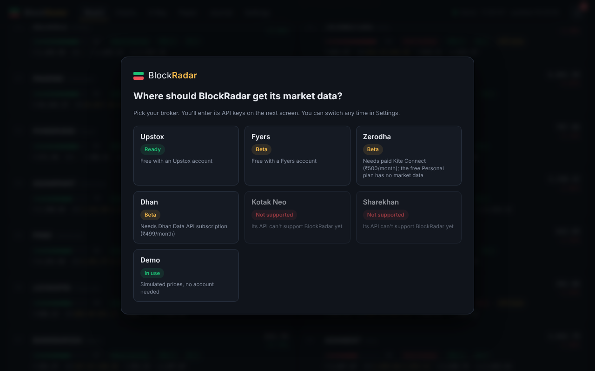

# Guide 1: Install BlockRadar on Windows

⏱️ About 10 minutes · No coding needed

[← Back to README](../../README.md) · Next: [Connect your broker →](02-connect-broker.md)

---

## Before you start: check your PC

| | You need |
|---|---|
| Windows | Windows 10 or 11, **64-bit** |
| Memory (RAM) | 4 GB or more (BlockRadar itself uses about 300 MB) |
| Free disk space | 200 MB |
| Internet | A stable broadband or Wi-Fi connection |
| Browser | Chrome, Edge or Firefox (recent version) |

**How to check:** press `Windows key` + `I` → **System** → **About**. Look at *System type* (must say **64-bit operating system**) and *Installed RAM*.

---

## Step 1: Install Python (one time only)

BlockRadar is written in Python, so your PC needs Python to run it.

1. Open <https://www.python.org/downloads/>.
2. Click the yellow **Download Python 3.x** button. Any version from **3.10 to 3.13** works.
3. Open the downloaded file.
4. ⚠️ **On the first screen, tick the box "Add python.exe to PATH".** This is the most common mistake; without it, BlockRadar can't find Python.
5. Click **Install Now** and wait until it says *Setup was successful*. Click **Close**.

**Check that it worked:**
1. Press the `Windows key`, type `cmd` and press Enter. A black window opens.
2. Type `python --version` and press Enter.
3. You should see something like `Python 3.12.7`. If you see an error or the Microsoft Store opens, repeat Step 1 and make sure you tick **Add python.exe to PATH**.

> Already have **Anaconda** installed? You can skip this step; BlockRadar finds Anaconda's Python automatically.

---

## Step 2: Download BlockRadar

1. Open the project page: <https://github.com/fkh786/BlockRadar>
2. Click the green **`<> Code`** button → **Download ZIP**.
3. Open your **Downloads** folder and find `BlockRadar-main.zip`.
4. **Unblock it** (this prevents a Windows security warning later): right-click the ZIP → **Properties** → at the bottom, tick **Unblock** → **OK**. If there's no Unblock box, skip this.
5. Right-click the ZIP → **Extract All…**
6. Choose a simple location, for example `C:\Users\YourName\Documents\BlockRadar`, and click **Extract**.

💡 Avoid extracting into a OneDrive-synced folder if you can. Syncing the app's files constantly can slow things down.

---

## Step 3: Start BlockRadar

1. Open the folder you extracted. You'll see files like `start.bat`, `README.md` and folders `app`, `static`.
2. **Double-click `start.bat`.**
3. If Windows shows **"Windows protected your PC"**, click **More info** → **Run anyway**. If it shows **"Open File – Security Warning"**, click **Run**. (This appears because the file came from the internet. You can read `start.bat` in Notepad first if you want to see exactly what it does.)
4. A black window opens. **The first time only**, it says *"First run: setting up BlockRadar"* and installs what it needs. This takes about 1 minute.
5. Your browser then opens **http://127.0.0.1:8000** by itself. If it doesn't, open your browser and type that address.

✅ **You should now see the BlockRadar page.**

⚠️ **Keep the black window open** while you use BlockRadar. Closing it stops the app. You can minimise it.

---

## Step 4: Choose where your data comes from

The first time you open BlockRadar, it asks **"Where should BlockRadar get its market data?"**

- **Just want to look around?** Click **Demo**. You'll see a simulated market moving in fast-forward, and every feature works.
- **Ready for real data?** Click your broker and follow [Guide 2: Connect your broker](02-connect-broker.md).

You can change this any time in **Settings → Data source**.

---

## Step 5 (optional): Make it easy to start every day

**Create a desktop shortcut:**
1. Right-click `start.bat` → **Show more options** (Windows 11) → **Send to** → **Desktop (create shortcut)**.
2. Rename the shortcut to `BlockRadar`.

**Stop your PC sleeping during market hours:**
`Windows key` + `I` → **System** → **Power & battery** (or *Power & sleep*) → set **"When plugged in, put my device to sleep after"** to **Never** (or longer than your trading session). If the PC sleeps, live updates stop.

---

## Next steps

- [Guide 2: Connect your broker](02-connect-broker.md)
- [Guide 3: Your daily routine](03-daily-routine.md)
- [Guide 4: How to use each screen](04-using-the-screens.md)
