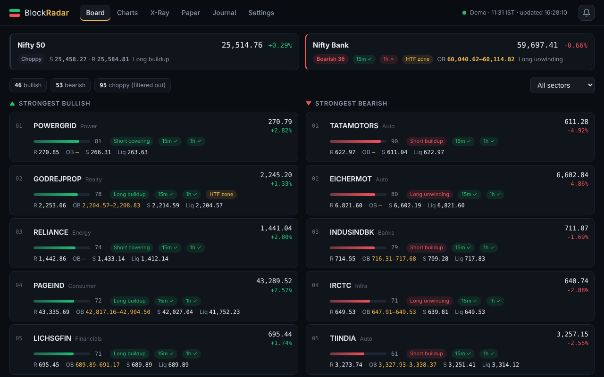
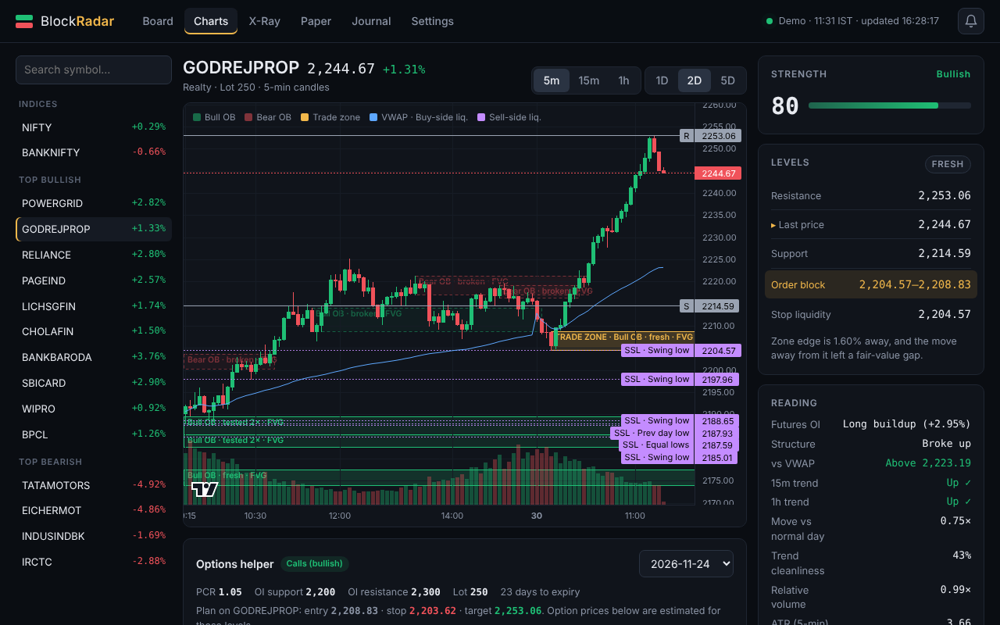
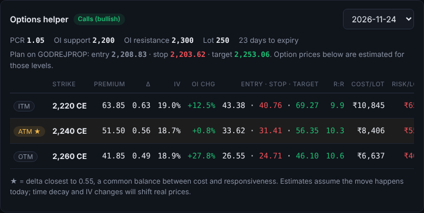
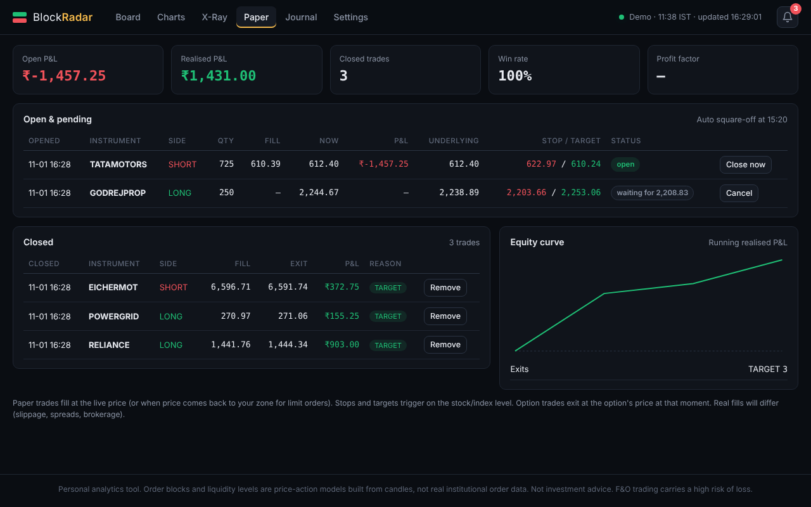
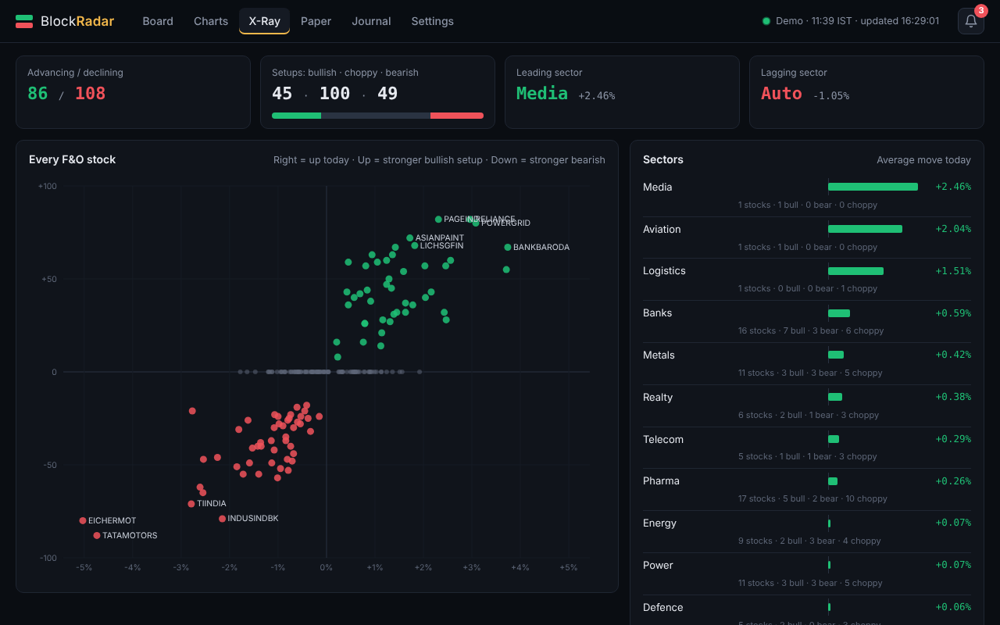

# Guide 4: How to use each screen

[← Back to README](../../README.md) · Previous: [Daily routine](03-daily-routine.md) · Next: [Update, back up, uninstall →](05-update-backup-uninstall.md)

**Screens:** [Board](#board) · [Charts](#charts) · [Options helper](#options-helper) · [Paper](#paper) · [Alerts](#alerts) · [X-Ray](#x-ray) · [Journal](#journal) · [Settings](#settings)

The **status** at the top right shows the data source, the market time and when the data was last updated (every minute with a broker, every few seconds in demo mode).

---

## Board

- **Top cards:** NIFTY 50 and Nifty Bank, with their bias, strength, zone and OI reading. Click one to open its chart.
- **Counts:** how many F&O stocks are bullish, bearish or choppy right now. Choppy ones are hidden from the lists.
- **Two lists:** the 20 strongest **bullish** and **bearish** stocks. On a phone-sized window, switch between them with the *Bullish / Bearish* buttons.
- **Sector filter:** show only one sector.

**Reading a row:**
| Part | Meaning |
|---|---|
| Green or red bar + number | Strength 0–100 |
| `Long buildup`, `Short covering`… | What futures OI is doing |
| `In OB zone` | Price is inside the trade zone right now |
| `Liquidity trap` | Stops were just swept and price reversed |
| `15m ✓ / 1h ✗` | Whether higher timeframes agree (✓) or disagree (✗) |
| `HTF zone` | The zone overlaps a higher-timeframe order block |
| `R` · `OB` · `S` · `Liq` | Resistance · order-block zone · support · nearest liquidity level |

---

## Charts

- **Left:** indices, top bullish and top bearish stocks, plus a search box (type a symbol and press Enter).
- **Timeframe buttons:** `5m` `15m` `1h`. **Days:** `1D` `2D` `5D`.
- **On the chart:**
  - 🟩 green boxes = **bullish order blocks**, 🟥 red boxes = **bearish order blocks**. Dashed boxes are broken (no longer valid).
  - 🟨 **gold box = TRADE ZONE**, the one to watch.
  - Blue dotted lines = **buy-side liquidity** (above price); purple = **sell-side liquidity** (below price).
  - Grey `R` / `S` lines = resistance / support. The thin blue curve = **VWAP**.
- **Right-hand card:**
  - **Strength** and bias.
  - **Levels:** a price ladder from resistance down to stop liquidity.
  - **Reading:** OI, structure, VWAP, 15m/1h trend, how big today's move is compared with normal, trend cleanliness, relative volume.
  - **Paper trade:** entry, stop, target, quantity and reward : risk. Click **Buy/Sell now** or **Limit at zone**.
  - **Log a trade:** opens the Journal with the plan filled in.

---

## Options helper

Below every chart:
1. Choose the **expiry** in the drop-down (nearest first).
2. Look at the top line: **PCR**, **OI support** (strike with the most put writing) and **OI resistance** (most call writing), the lot size and the days to expiry.
3. Read any **yellow warnings**. For example: *"Expiry is today/tomorrow"*, *"Reward is only 0.8× the risk"*.
4. The table shows **ITM, ATM, OTM** strikes for **calls** (bullish setups) or **puts** (bearish):
   - **Entry · Stop · Target** = the estimated option prices when the stock reaches its entry, stop and target levels
   - **Cost/lot**, **Risk/lot**, **Decay/day** (time decay per lot)
   - ★ = the strike with delta closest to 0.55, a common balance between cost and responsiveness
5. Click **Paper buy** to practise with one lot.

The option prices are estimates; real prices also change with time decay and volatility.

---

## Paper

  (simulated demo data)

- **Open & pending:** live P&L, the stock's current price, stop/target, and status. *Waiting for…* means a limit order is waiting for price to reach the zone. Click **Close now** or **Cancel**.
- **Closed:** each trade's fill, exit, P&L and exit reason (`TARGET`, `STOP`, `EOD`, `MANUAL`).
- **Equity curve:** your running realised P&L.
- Stops and targets trigger on the **stock or index price**. Option trades exit at the option's price at that moment.
- Open trades are squared off at **15:20** (you can turn this off in Settings).

---

## Alerts

Click the 🔔 bell (top right) to see recent alerts. Click an alert to open that chart.

**Turn them on:** **Settings → Alerts**
1. Choose what to be told about: *price enters a trade zone*, *liquidity trap*, *stock enters the top 5*, *paper trade fills/stops/targets*.
2. **Minimum strength:** only alert for stocks at least this strong (default 60).
3. **Repeat gap:** don't repeat the same alert for the same stock within N minutes.
4. Tick **Play a sound** and **Desktop pop-up**. Your browser asks for permission; click **Allow**.
5. Click **Save alert settings**, then **Send test alert**.

**Telegram alerts on your phone (optional):**
1. In Telegram, open **@BotFather** → send `/newbot` → choose a name → copy the **token** it gives you.
2. Open your new bot and send it any message (for example `hi`).
3. Open **@userinfobot** → it replies with your **Id** (a number). That's your **chat ID**.
4. In BlockRadar: **Settings → Alerts → Telegram alerts** → paste the **Bot token** and **Chat ID** → **Save alert settings** → **Send test alert**.

---

## X-Ray

- **Tiles:** advancing vs declining stocks; bullish / choppy / bearish setups; leading and lagging sector.
- **Map:** every F&O stock. **Right** = up today, **left** = down. **Higher** = stronger bullish setup, **lower** = stronger bearish setup; dots on the middle line are choppy. Hover a dot for details; click it to open the chart.
- **Sectors:** the average move of each sector today, with counts of bullish and bearish stocks.

---

## Journal

For your **real** trades.
1. Fill in the date, symbol, side, quantity, entry, stop and target (and exit, once closed), the setup and notes → **Save trade**. Leave Exit blank while the trade is open.
2. The tiles show closed trades, win rate, net P&L, average R and profit factor.
3. **By setup** shows which setups actually make you money.
4. Use **Edit** to add the exit later. **Delete** asks *"Sure?"* before deleting.

---

## Settings

- **Data source:** choose and connect your broker, or Demo. See [Guide 2](02-connect-broker.md).
- **Alerts:** see [Alerts](#alerts) above.
- **Square off paper trades at 15:20:** on or off.
