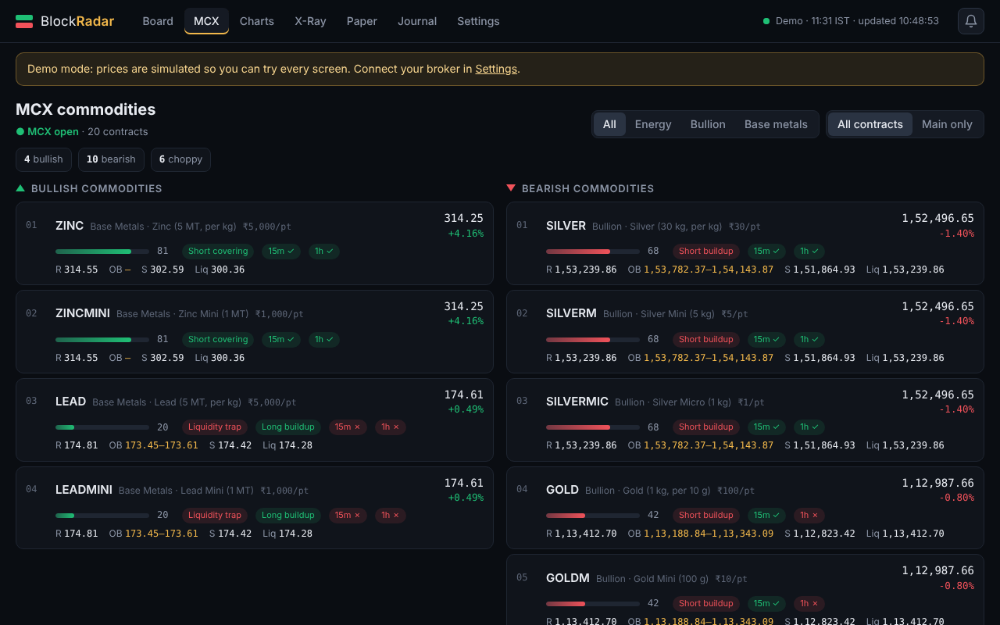

# Guide 7: MCX commodities

[← Back to README](../../README.md) · Previous: [Install on Mac or Linux](06-mac-linux.md)

The **MCX** tab scans commodity futures with the same order-block engine as the stock board: crude oil, natural gas, gold, silver and base metals.

---

## What's covered

20 contracts, in three groups:

| Group | Main contracts | Mini / micro contracts |
|---|---|---|
| **Energy** | CRUDEOIL, NATURALGAS | CRUDEOILM, NATGASMINI |
| **Bullion** | GOLD, GOLDM, SILVER, SILVERM | GOLDTEN, GOLDGUINEA, GOLDPETAL, SILVERMIC |
| **Base metals** | COPPER, ZINC, ALUMINIUM, LEAD | ZINCMINI, ALUMINI, LEADMINI, COPPERM (if listed) |

The "main 10" are CRUDEOIL, NATURALGAS, GOLD, GOLDM, SILVER, SILVERM, COPPER, ZINC, ALUMINIUM and LEAD. Mini and micro contracts follow the same commodity at a smaller size, so they usually show the same setup as their parent.

It works with every broker in BlockRadar (Upstox, Fyers, Zerodha, Dhan) and in demo mode. You don't need anything extra, but your broker account must allow MCX market data. If it doesn't, the MCX tab shows a short message and the stock board keeps working.

---

## Trading hours

- MCX trades **09:00 to 23:30 IST**, or **09:00 to 23:55** while the US is on summer time (second Sunday of March to first Sunday of November). BlockRadar switches automatically.
- After 15:30 the stock board stops updating, but the MCX tab keeps going. The status bar shows **MCX open**.
- Broker logins still expire overnight, so log in once each morning as usual. That one login covers both NSE and MCX.

---

## Using the MCX tab

1. Click **MCX** in the top bar.
2. **Bullish commodities** (left) and **Bearish commodities** (right) are ranked by strength, exactly like the stock board.
3. **No clear setup right now** (below) lists the choppy ones. Click any of them to see the chart anyway.
4. Filters:
   - **All / Energy / Bullion / Base metals**
   - **All contracts / Main only** (hide the mini and micro contracts)
5. Click a row to open its **chart**, **options helper** and **paper-trade** box.

### ₹/pt: what one point is worth

Each row shows **₹/pt**: the profit or loss on **one lot** when the price moves by ₹1.

| Contract | ₹/pt | Example |
|---|---|---|
| CRUDEOIL | ₹100 | a ₹20 move = ₹2,000 per lot |
| CRUDEOILM | ₹10 | a ₹20 move = ₹200 per lot |
| NATURALGAS | ₹1,250 | a ₹2 move = ₹2,500 per lot |
| GOLD | ₹100 | a ₹500 move (per 10 g) = ₹50,000 per lot |
| GOLDM | ₹10 | a ₹500 move = ₹5,000 per lot |
| SILVER | ₹30 | a ₹1,000 move (per kg) = ₹30,000 per lot |
| SILVERM | ₹5 | a ₹1,000 move = ₹5,000 per lot |
| COPPER | ₹2,500 | a ₹2 move (per kg) = ₹5,000 per lot |

These come from MCX contract specifications. If MCX changes a lot size, edit the second number for that contract in `app/universe.py` (the `MCX` table).

### Which contract is used

BlockRadar uses the **near-month future** for price, charts and OI. Three days before it expires, it switches to next month's contract, so you aren't looking at a contract about to expire. The chart's subtitle shows the exact contract (for example `CRUDEOIL26DECFUT`). To change the 3 days, edit `MCX_ROLL_DAYS` in `app/universe.py`.

The 15-minute and 1-hour candles start at **09:00** for MCX, not 09:15.

---

## Options helper for commodities

Brokers' option-chain APIs don't cover MCX, so BlockRadar builds the chain itself:

- It takes the option contracts from your broker's instrument list.
- It gets live premiums for about 12 strikes either side of the future's price.
- It calculates IV, delta and theta from those premiums (options on futures, Black-76).

What you see is the same as for stocks: calls or puts, ITM / ATM / OTM strikes, entry / stop / target in option prices, and cost and risk per lot. Differences:

- **OI change** isn't available for MCX options (OI is shown where your broker provides it).
- With **Fyers**, option OI shows as 0 because Fyers quotes don't include OI.

---

## Paper trading commodities

- The paper-trade box asks for **Lots** (not quantity) for commodities. P&L = price move × ₹/pt × lots.
- Option paper trades are 1 lot by default.
- With **Square off paper trades before the close** on (Settings), open commodity trades close **10 minutes before the MCX close**: 23:20, or 23:45 during US summer time. Stock trades still close at 15:20.

---

## Alerts

Commodity zone and trap alerts work like stock alerts and start with **"MCX"**, for example *"MCX CRUDEOIL entered its bullish order block"*.

To stop them, untick **Settings → Alerts → MCX commodities: zone and trap alerts**.

---

## Good to know

- MCX evening sessions often move on US data (inventories, jobs, Fed). Zones break more easily around those times.
- Live volume on the current candle is estimated from the day's total and corrected when candles are re-downloaded (every few minutes).
- Exchange holidays aren't hard-coded. On an MCX holiday the tab shows the last session.
